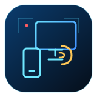
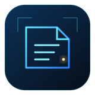

<p align="center">
  <picture>
    <source media="(prefers-color-scheme: dark) and (max-width: 700px)" srcset="assets/hero-mobile-dark.svg">
    <source media="(prefers-color-scheme: light) and (max-width: 700px)" srcset="assets/hero-mobile-light.svg">
    <source media="(prefers-color-scheme: dark)" srcset="assets/hero-dark.svg">
    <source media="(prefers-color-scheme: light)" srcset="assets/hero-light.svg">
    
  </picture>
</p>

<p align="center">
  <a href="https://github.com/Builder0615/my-blog"></a>
  &nbsp;
  <a href="https://github.com/Builder0615?tab=repositories"></a>
</p>

<p align="center">
  <code>STATUS</code> building<br>
  <code>FOCUS</code> cross-device tools &nbsp;·&nbsp; AI workflows &nbsp;·&nbsp; local-first software
</p>

## 你好，我是 Builder

一个喜欢把「不方便」做成软件的开发者。  
桌面、移动、AI 工具都在做，但目标始终一样：把复杂流程压缩成一个按钮、一条快捷键，或一条更短的路径。

> 先让它跑起来，再让它变漂亮。

```bash
$ builder --status
mode      building
focus     cross-device & agent tools
stack     Rust · Tauri · Flutter
rule      ship small · stay local
```

## 最近在造什么

<table>
  <tr>
    <td width="92" align="center" valign="middle">
      
    </td>
    <td valign="top">
      <p>
        <sub>01 / DESKTOP · MULTI-DEVICE</sub><br>
        <a href="https://github.com/Builder0615/phonebridge"><b>快投屏 / PhoneBridge</b></a><br>
        <sub>把 iPhone 与 Android 的屏幕、键鼠和文字输入收进一个桌面工作台。</sub>
      </p>
      <p><code>Tauri 2</code> <code>Rust</code> <code>React</code></p>
    </td>
  </tr>
  <tr>
    <td width="92" align="center" valign="middle">
      
    </td>
    <td valign="top">
      <p>
        <sub>02 / EDITOR TOOL · SHIPPED</sub><br>
        <a href="https://github.com/Builder0615/mask-book"><b>Mask Book</b></a><br>
        <sub>藏在 VS Code 状态栏里的本地阅读器，支持 EPUB、FB2、PDF、TXT 等格式。</sub>
      </p>
      <p><code>TypeScript</code> <code>VS Code API</code></p>
    </td>
  </tr>
  <tr>
    <td width="92" align="center" valign="middle">
      
    </td>
    <td valign="top">
      <p>
        <sub>03 / FIELD NOTES · AGENT SYSTEMS</sub><br>
        <a href="https://github.com/Builder0615/my-blog"><b>Agent Source Notes</b></a><br>
        <sub>从 Pi 与 Grok Build 源码出发，拆开 Agent loop、session、工具系统和终端界面。</sub>
      </p>
      <p><code>Research</code> <code>Documentation</code></p>
    </td>
  </tr>
</table>

**二次开发与工具链**  
[OmniGet](https://github.com/Builder0615/omniget) · [MoreTalk](https://github.com/Builder0615/moretalk) · [Toaster](https://github.com/Builder0615/Toaster) · [DecoTV](https://github.com/Builder0615/DecoTV)

<sub>部分项目源自上游开源仓库的二次开发或维护分支；另外还有一些 Android、Flutter 与 Agent 工作流实验在私有仓库里持续迭代。</sub>

## 工具箱

<p>
  
  
  
  
  
  
  
  
</p>

`桌面` Rust · Tauri · React  
`移动` Flutter · Dart · Kotlin · Swift  
`Web / 服务` TypeScript · Vue · JavaScript  
`AI / 自动化` Python · Agents · 本地优先工作流

## 构建遥测

<p align="center">
  <picture>
    <source media="(prefers-color-scheme: dark) and (max-width: 700px)" srcset="assets/telemetry-mobile-dark.svg">
    <source media="(prefers-color-scheme: light) and (max-width: 700px)" srcset="assets/telemetry-mobile-light.svg">
    <source media="(prefers-color-scheme: dark)" srcset="assets/telemetry-dark.svg">
    <source media="(prefers-color-scheme: light)" srcset="assets/telemetry-light.svg">
    
  </picture><br>
  <sub>工作区快照 · 43 个仓库（公开 + 私有）· 不含 Fork 的 34 个原创项目</sub>
</p>

## 提交轨迹

<p align="center">
  <picture>
    <source media="(prefers-color-scheme: dark)" srcset="https://raw.githubusercontent.com/Builder0615/Builder0615/output/github-contribution-grid-snake-dark.svg">
    <source media="(prefers-color-scheme: light)" srcset="https://raw.githubusercontent.com/Builder0615/Builder0615/output/github-contribution-grid-snake.svg">
    
  </picture><br>
  <sub>由 GitHub Actions 每日重绘</sub>
</p>

<details>
  <summary><b>我的构建原则</b></summary>
  <br>

  - 先用最短路径跑通，再补边界条件。
  - 能本地完成的事，不急着上云。
  - 插件化是为了减少耦合，不是为了增加配置。
  - 一个功能如果让日常路径更长，就不应该默认开启。

</details>

<br>

<p align="center">
  <sub>BUILD · BREAK · FIX · SHIP</sub><br>
  <sub>还没有「完成」，只有下一个版本。</sub>
</p>
